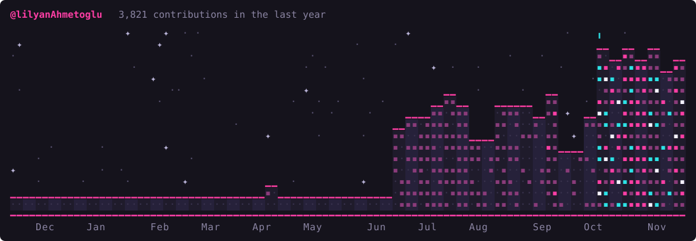

# Hi, I'm Lilyan 👋

**Senior Software Engineer · Web Platform Architecture · AI Engineering**

I am a software engineer with 10 years of experience, based in **Dresden, Germany**. I build production systems across web platforms, cloud data and applied AI. I own problems end to end: from business needs to architecture, delivery and operations.

At **BAUHAUS** I architected the **App Shell** of [bauhaus.info](https://www.bauhaus.info). It is the Next.js/React foundation of the web shop and its new PWA. Every Digital Commerce feature team ships on it.

Outside work, I founded two AI products, I build open-source tools for AI coding agents, and I wrote a 202-page course on how LLMs work.

---

### 🚀 Products I'm building

#### 🐱 [chazi.ai](https://chazi.ai) · Founder
An AI companion with **long-term memory**. Your pixel pet talks with you, and it remembers your life over years, not just one chat.
- Layered memory pipeline: raw journal data → events → a long-term life timeline. It keeps what matters and forgets the noise.
- Voice hardware prototype on **ESP32-S3**, with its own voice server.

#### 👕 [Baski.ai](https://baski.ai) · Founder
A chat-first, AI print-on-demand app. An **AI sales agent** takes a customer from an idea to a printed product in one conversation.
- Token-efficient agent design: a structured order brief replaces the full chat history on each loop.
- Built solo, end to end: React Native / Expo mobile app, Next.js web, Stripe payments, print fulfillment integration.

---

### 🧰 Open source

| Project | What it does |
|---|---|
| **[Parallelo Session](https://github.com/lilyanAhmetoglu/parallelo)** | VS Code extension for parallel AI coding agents (Claude Code, Codex, aider). Diff, file tree and status bar follow the active terminal. A conflict radar warns when two sessions edit the same file. On the VS Code Marketplace and Open VSX. |
| **[roundtable](https://github.com/lilyanAhmetoglu/roundtable)** | MCP server for multi-agent design review. Two coding agents debate a plan in a shared room; the server enforces turns, round budget and closure. Lock-free, crash-safe design. On npm as `roundtable-mcp`. |
| **[Sigmorai](https://github.com/lilyanAhmetoglu/sigmorai)** | Open-source RPG for learning AI engineering ([sigmorai.com](https://sigmorai.com)). RAG mentor on Claude with Voyage AI embeddings in pgvector, with token and cost tracking per question. Playwright E2E and WCAG 2.1 AA checks on every PR. |
| **From Vectors to Transformers** | Open course and book (202 pages, 41 lessons, 82 figures). It takes a software engineer from linear algebra to reading *Attention Is All You Need* line by line. |

---

### 🛠️ Tech stack

**AI & LLM engineering:** agent loops, context management, MCP, multi-agent orchestration, RAG, vector search (pgvector), long-term memory, Claude Code, Anthropic & OpenAI APIs

**Languages:** TypeScript · JavaScript · Python · SQL · Java

**Frontend & mobile:** React · Next.js · PWA · React Native / Expo · Angular

**Backend & APIs:** Node.js · Bun · GraphQL · REST · Spring Boot

**Data engineering:** BigQuery · Looker · Azure Data Factory · Synapse · PostgreSQL · MS SQL · ETL/ELT

**Cloud & DevOps:** GCP · AWS · Azure · Terraform · Docker · GitHub Actions · Nx monorepos · Playwright

---

### 💼 Experience

- **Senior Software Engineer**, BAUHAUS Digital Commerce · *2022 – now*
  App Shell architecture, shared platform standards, GCP infrastructure with Terraform, CI/CD on GitHub Actions, data pipelines with BigQuery and Looker. Member of the internal AI community.
- **Data Engineer (Consultant)**, Qimia GmbH for Schaeffler · *2022*
  ETL pipelines in Azure Data Factory and Synapse, data marts and Power BI reporting.
- **Full-Stack Developer**, Qimia GmbH · *2019 – 2022*
  Client apps with React, Node.js, GraphQL and Python; AWS infrastructure.

🎓 B.Sc. Computer Science, Istanbul University · 🌍 Arabic, Turkish, English

---

### 🌐 Find me

[LinkedIn](https://www.linkedin.com/in/lilyan-aldimashki-246168aa/) · [chazi.ai](https://chazi.ai) · [baski.ai](https://baski.ai) · [sigmorai.com](https://sigmorai.com)

### 🏙️ My year in code

My contribution graph as a city, redrawn every night by [skyline](https://github.com/pinkpixel-dev/skyline).
